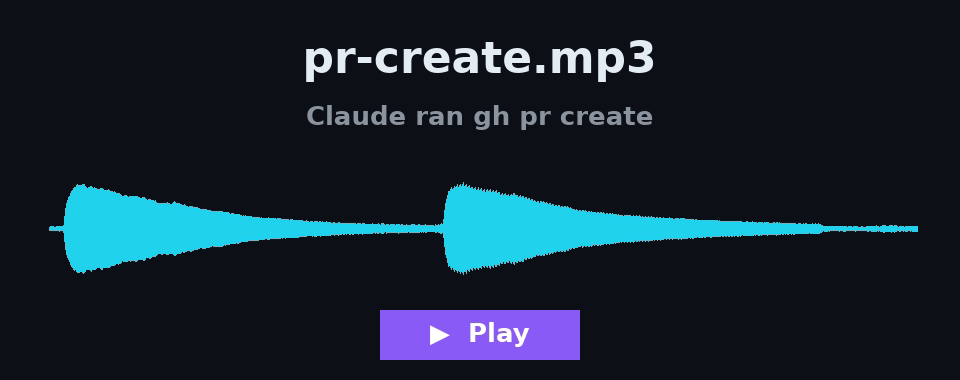
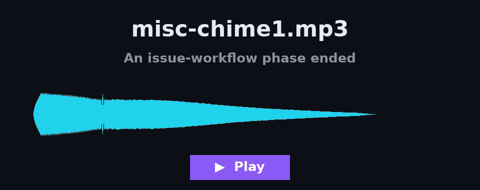
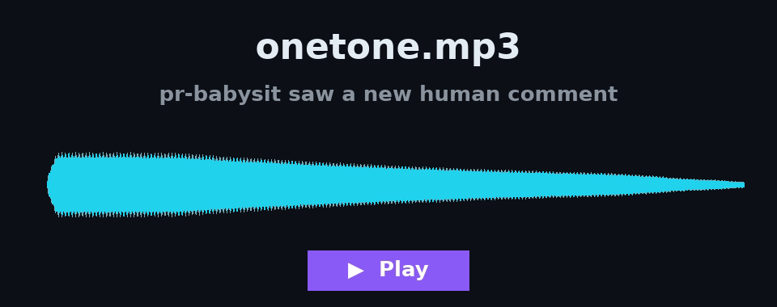
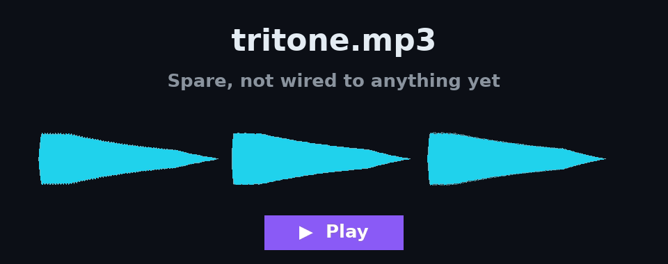

# pr-sound

Claude Code plugin that plays a chime whenever Claude runs `gh pr create`, and another whenever Claude prints a line `ENDING WORKFLOW PHASE: <NAME>` (the `issue-workflow` skill's phase markers). The `CREATE-PR` phase gets no phase chime, since its PR chime already plays.

## Hear the sounds

Click a card to play it.

| | |
|---|---|
| [](https://relatively-okay.github.io/pr-sound/#pr-create) | [](https://relatively-okay.github.io/pr-sound/#misc-chime1) |
| [](https://relatively-okay.github.io/pr-sound/#onetone) | [](https://relatively-okay.github.io/pr-sound/#tritone) |

## Install

```sh
claude plugin marketplace add relatively-okay/pr-sound && claude plugin install pr-sound@pr-sound
```

## Dependency

```sh
sudo apt install mpg123
```
